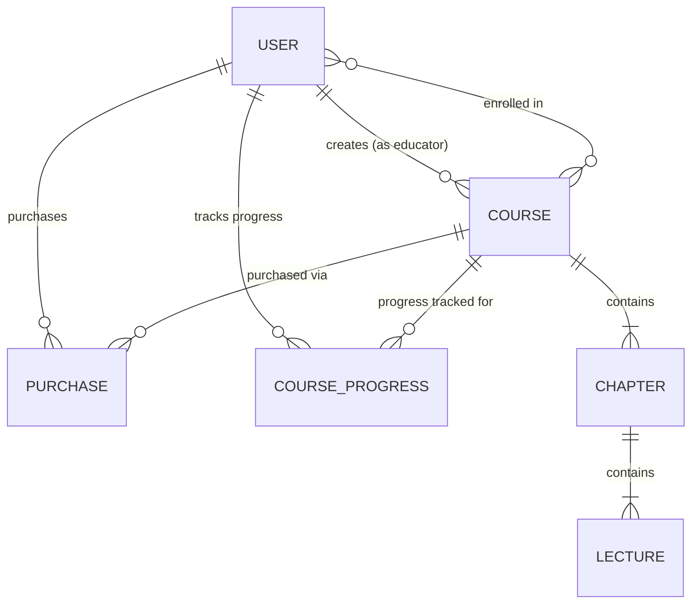

# Database Design & Mongoose Schemas

This document provides a comprehensive specification of the MongoDB database design, Mongoose models, schema definitions, relationships, and indexing strategies utilized in the WhiteDavid23 Advanced LMS platform.

---

## 1. Entity-Relationship (ER) Diagram

---

## 2. Model Specifications

### 2.1 User Model (`server/model/user.model.js`)

Represents all accounts in the system (students, educators, administrators).

| Field | Type | Validation / Constraints | Description |
| :--- | :--- | :--- | :--- |
| `name` | `String` | `required: true, trim: true` | User's full display name |
| `email` | `String` | `required: true, unique: true, lowercase: true` | Account email address |
| `password` | `String` | `required: true, minlength: 6` | Bcrypt-hashed password |
| `role` | `String` | `enum: ['student', 'educator', 'admin'], default: 'student'` | Access role for authorization |
| `enrolledCourses`| `[ObjectId]` | `ref: 'Course'` | Array of enrolled course IDs |
| `profileImage` | `String` | `default: ''` | Cloudinary or MEGA avatar URL |
| `headline` | `String` | `default: '', maxlen: 120` | User title or short headline |
| `bio` | `String` | `default: '', maxlen: 500` | User biography description |
| `socialLinks` | `Object` | `{ github, linkedin, twitter, website }` | External portfolio links |
| `otp` | `String` | `default: null` | 6-digit registration OTP code |
| `otpExpires` | `Date` | `default: null` | OTP expiration timestamp (10 min) |
| `resetOtp` | `String` | `default: null` | 6-digit password reset OTP |
| `resetOtpExpires`| `Date` | `default: null` | Reset OTP expiration timestamp |
| `timestamps` | `Boolean` | Auto-managed | `createdAt` and `updatedAt` |

---

### 2.2 Course Model (`server/model/course.model.js`)

Represents a complete course curriculum created by an educator.

| Field | Type | Validation / Constraints | Description |
| :--- | :--- | :--- | :--- |
| `title` | `String` | `required: true, trim: true` | Course title |
| `subTitle` | `String` | `trim: true` | Short course summary headline |
| `description` | `String` | `required: true` | Detailed course overview |
| `price` | `Number` | `required: true, min: 0` | Base price in INR / local currency |
| `discount` | `Number` | `default: 0, min: 0, max: 100` | Percentage discount applied |
| `category` | `String` | `default: 'Development'` | Course category |
| `level` | `String` | `enum: ['Beginner', 'Intermediate', 'Advanced', 'All Levels']` | Target skill level |
| `language` | `String` | `default: 'English'` | Instruction language |
| `thumbnail` | `String` | `required: true` | Banner image URL (Cloudinary / MEGA) |
| `educator` | `ObjectId` | `ref: 'User', required: true` | Author educator ID |
| `chapters` | `[ObjectId]`| `ref: 'Chapter'` | Ordered list of curriculum chapters |
| `enrolledStudents`| `[ObjectId]`| `ref: 'User'` | Array of enrolled student IDs |
| `courseRatings` | `[Number]`| Array of integers (1 to 5) | Numeric ratings submitted by students |
| `reviews` | `[Object]` | Embedded subdocuments | Student text reviews and ratings |
| `isPublished` | `Boolean` | `default: false` | Public catalog visibility flag |
| `timestamps` | `Boolean` | Auto-managed | `createdAt` and `updatedAt` |

---

### 2.3 Chapter Model (`server/model/chapter.model.js`)

Represents a thematic section or module within a course.

| Field | Type | Validation / Constraints | Description |
| :--- | :--- | :--- | :--- |
| `chapterTitle` | `String` | `required: true, trim: true` | Chapter name (e.g., "Section 1: Basics") |
| `chapterOrder` | `Number` | `required: true, default: 0` | 0-indexed sorting position |
| `courseId` | `ObjectId` | `ref: 'Course', required: true` | Parent course reference |
| `chapterContent`| `[ObjectId]`| `ref: 'Lecture'` | Ordered array of lecture IDs |
| `timestamps` | `Boolean` | Auto-managed | `createdAt` and `updatedAt` |

---

### 2.4 Lecture Model (`server/model/lecture.model.js`)

Represents an individual video or document lesson within a chapter.

| Field | Type | Validation / Constraints | Description |
| :--- | :--- | :--- | :--- |
| `title` | `String` | `required: true, trim: true` | Lecture lesson title |
| `videoUrl` | `String` | `default: ''` | Video stream or embed URL (MEGA / Cloudinary) |
| `videoDuration`| `Number` | `default: 0` | Video duration in seconds |
| `isPreviewFree` | `Boolean` | `default: false` | If true, accessible without course purchase |
| `order` | `Number` | `default: 0` | Sort order within the parent chapter |
| `documentUrl` | `String` | `default: ''` | Optional lecture PDF slides or document URL |
| `lectureType` | `String` | `enum: ['video', 'document'], default: 'video'` | Media rendering mode |
| `chapterId` | `ObjectId` | `ref: 'Chapter', required: true` | Parent chapter reference |
| `courseId` | `ObjectId` | `ref: 'Course', required: true` | Parent course reference |
| `timestamps` | `Boolean` | Auto-managed | `createdAt` and `updatedAt` |

---

### 2.5 CourseProgress Model (`server/model/courseProgress.model.js`)

Tracks individual student progress, lecture completions, and playback resume state.

| Field | Type | Validation / Constraints | Description |
| :--- | :--- | :--- | :--- |
| `userId` | `ObjectId` | `ref: 'User', required: true` | Student user reference |
| `courseId` | `ObjectId` | `ref: 'Course', required: true` | Enrolled course reference |
| `completedLectures` | `[Object]` | `[{ chapter, lecture, lectureId, chapterId, completedAt }]` | Set of lectures completed by student |
| `lastPosition` | `Object` | `{ chapter: Number, lecture: Number, lectureId: ObjectId, updatedAt: Date }` | Last watched lecture for quick resume |
| `timestamps` | `Boolean` | Auto-managed | `createdAt` and `updatedAt` |

*Index*: Compound unique index `{ userId: 1, courseId: 1 }` guarantees a single progress record per student-course pair.

---

### 2.6 Purchase Model (`server/model/purchase.model.js`)

Records course enrollment transactions and payment logs.

| Field | Type | Validation / Constraints | Description |
| :--- | :--- | :--- | :--- |
| `userId` | `ObjectId` | `ref: 'User', required: true` | Purchasing user ID |
| `courseId` | `ObjectId` | `ref: 'Course', required: true` | Purchased course ID |
| `amount` | `Number` | `required: true` | Final paid price after discount |
| `paymentId` | `String` | `default: ''` | Stripe PaymentIntent or manual ID |
| `status` | `String` | `enum: ['pending', 'completed', 'failed'], default: 'completed'` | Transaction status |
| `timestamps` | `Boolean` | Auto-managed | `createdAt` and `updatedAt` |

---

## 3. Database Indexes & Query Optimizations

To ensure sub-millisecond query responses under high student concurrency:
1. `User.email`: Unique index for instant authentication lookups.
2. `Course.isPublished`: Single-field index for filtering public catalog items.
3. `Course.category`: Index for categorized filtering.
4. `CourseProgress`: Compound index on `{ userId: 1, courseId: 1 }`.
5. `Chapter.courseId` & `Lecture.chapterId`: Foreign key indexes for rapid curriculum population.
