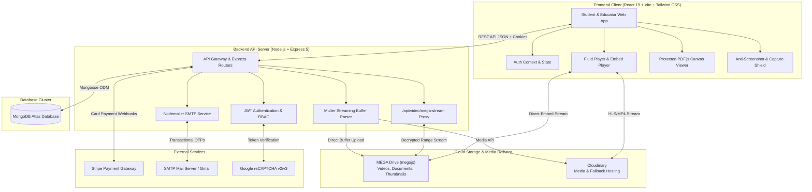

# WhiteDavid23 Advanced LMS — Comprehensive Project Documentation

Welcome to the official documentation for the **WhiteDavid23 Advanced Learning Management System (LMS)**. This documentation provides an in-depth, section-wise breakdown of the entire full-stack architecture, database models, REST APIs, frontend components, DRM content security, and all third-party integrations (including MEGA Drive, Cloudinary, Stripe, Nodemailer, and Fluid Player).

---

## 📚 Documentation Directory & Navigation

All documentation files are organized cleanly in this `Docs/` directory:

| Document | Description | Key Focus Areas |
| :--- | :--- | :--- |
| **[1. System Architecture & Overview](SYSTEM_ARCHITECTURE.md)** | High-level system design, tech stack, data flow, and directory layouts | Node.js, Express, React 19, MongoDB, Vite, Tailwind CSS |
| **[2. MEGA Drive Integration Guide](MEGA_DRIVE_INTEGRATION.md)** | **Dedicated Guide:** MEGA Cloud Drive storage integration via `megajs` | Singleton connection, auto-folder structure, buffer uploads, embed players, streaming proxy |
| **[3. External Services & Integrations](EXTERNAL_SERVICES_AND_INTEGRATIONS.md)** | Complete third-party cloud tools & services guide | Cloudinary, MongoDB Atlas, Stripe, Nodemailer/SMTP, reCAPTCHA, Fluid Player, PDF.js |
| **[4. Complete REST API Reference](API_DOCUMENTATION.md)** | Exhaustive API endpoint reference with request/response payloads | Auth, Courses, Chapters, Lectures, User/Progress, Media Uploads |
| **[5. Database Design & Data Models](DATABASE_MODELS.md)** | MongoDB/Mongoose schemas, ER relationships, indexes, and validation | User, Course, Chapter, Lecture, Purchase, CourseProgress |
| **[6. DRM & Content Protection System](CONTENT_PROTECTION_AND_SECURITY.md)** | Multi-layer anti-screenshot and anti-screen-recording defenses | Window blur blackout, PrintScreen intercept, dynamic roaming watermark, `getDisplayMedia` block |
| **[7. Frontend Architecture Guide](FRONTEND_ARCHITECTURE.md)** | React 19 client structure, AuthContext, UI components, student & educator portals | Video player, PDF viewer, curriculum sidebar, responsive design |
| **[8. Setup, Configuration & Deployment](DEPLOYMENT_AND_SETUP.md)** | Step-by-step local setup, environment variables, Render & Vercel deployment | Environment config, CORS, reverse proxy trust, build steps |

---

## 🏛️ High-Level System Architecture Diagram



---

## ⚡ Core Highlights & Capabilities

1. **Role-Based LMS Experience**:
   - **Student Portal**: Course catalog search, enrolled courses dashboard, interactive lecture room with progress tracking, notes editor, reviews, and profile customization.
   - **Educator Portal**: Course creation wizard, chapter and lecture management, video & document uploads, student enrollment management, and revenue analytics.

2. **Dual Cloud Storage Architecture**:
   - **Primary Storage**: Direct integration with **MEGA Drive** (`megajs`), providing high-capacity, cost-free cloud storage with automated directory creation (`Videos`, `Thumbnails`, `Documents`, `Profile-Pictures`), public embed transformations, and decrypted streaming proxies.
   - **Secondary/Fallback Storage**: **Cloudinary** integration for optimized video transformations, thumbnail generation, and document hosting.

3. **Enterprise DRM & Content Protection**:
   - **Snipping Tool & OBS Blackout Shield**: Instantly hides and pauses video when the browser window loses focus or screen-clipping tools are invoked.
   - **Shortcut Interception**: Blocks `PrintScreen`, `Win+Shift+S`, `Cmd+Shift+3/4`, `Ctrl+P`, `Ctrl+S`, `F12`, and DevTools shortcuts, while auto-clearing the OS clipboard.
   - **Dynamic Roaming Watermark**: Semi-transparent badge showing the student's email, ID, and live timestamp roaming across the screen to permanently deter external screen recorders and phone recordings.
   - **Screen Recording API Blocker**: Intercepts `navigator.mediaDevices.getDisplayMedia` to prevent browser extensions and web recorders from capturing course streams.

4. **Zero-Download Protected PDF Engine**:
   - Built with `pdfjs-dist` rendering directly to HTML5 canvas with right-click, download, and print prevention.

---

## 🚀 Quick Start for Developers

1. **Backend Server Setup**:
   ```bash
   cd server
   cp .env.sample .env
   # Fill in MONGODB_URI, JWT_TOKEN, MEGA_EMAIL, MEGA_PASSWORD, etc.
   npm install
   npm run dev
   ```

2. **Frontend Client Setup**:
   ```bash
   cd client
   npm install
   npm run dev
   ```

For detailed setup instructions, refer to **[DEPLOYMENT_AND_SETUP.md](DEPLOYMENT_AND_SETUP.md)**.
